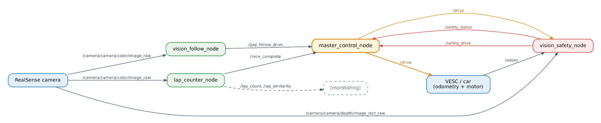

# About the Repository

package contains the following:

| Node | Sensor | What it does |
|---|---|---|
| `vision_follow_node` | rgb camera | Finds the free floor in the image and drives toward the longest open path |
| `vision_safety_node` | depth camera + odometry | Automatic emergency braking using TTC from the depth image. |
| `lap_counter_node` | rgb camera | Recognises the start line, counts laps, and stops the car after `target_laps`. |
| `master_control_node` | (none) | Arbiter. The only node that publishes to `/drive`; decides whether the follower or the safety node gets control. |
| `gap_follow_node` | LIDAR | Same ray logic and parameters as `vision_follow_node`, run on the LIDAR scan. |
| `wall_follow_node` | LIDAR | Milestone 2 PD wall follower. |
| `safety_node` | LIDAR + odometry | Milestone 2 emergency braking. |

The launch file picks one safety node and one follower, so the same package can run camer and LIDAR nodes.

```
src/
├── config/params.yaml          # every tunable value, one block per node
├── launch/milestone3_launch.py # starts safety + master_control + follower + lap counter
└── Racing_System/
    ├── vision_follow_node.py
    ├── vision_safety_node.py
    ├── laps_counting_node.py   # runs as lap_counter_node
    ├── master_control_node.py
    ├── gap_follow_node.py      # vision_follow_node's ray logic on the LIDAR
    ├── wall_follow_node.py     # Milestone 2
    ├── safety_node.py          # Milestone 2
    └── vision/                 # helper code used by vision_follow_node
        ├── camera_model.py     # pixel <-> floor geometry
        ├── free_space.py       # floor mask, clean-up, obstacle padding
        └── rays.py             # ray casting over the mask
```

# System Diagram

Assuming a camera-only setup (`safety:=camera mode:=vision`). Arrows are topics.



With the other launch options, the boxes change but the topics stay the same:

- `safety:=lidar` replaces `vision_safety_node` with `safety_node`, which reads `/scan`, `/odom` and `/drive` and publishes the same `/safety_status` and `/safety_drive`.
- `mode:=gap` replaces `vision_follow_node` with `gap_follow_node`, which reads `/scan` and publishes `/gap_follow_drive`. It runs the same ray logic as the vision follower (see below), so the two can be swapped without retuning.
- `mode:=wall` uses `wall_follow_node`, which reads `/scan` and publishes `/wall_follow_drive`. master_control forwards that topic instead.

# Algorithm Description

## Auto Drive - Vision Follow Node

`vision_follow_node` is gap-follow with a camera instead of a LIDAR. It runs once per colour frame:

1. **Find the floor.** The image is converted to HSV. A pixel counts as floor if it's bright (`V >= v_floor_min`) and grey (`S <= s_floor_max`). Our track floor is light grey and the walls are black ducts, so the ducts fail the brightness check.
2. **Clean the mask.** Three morphology passes. An open with an `open_kernel` square removes small specks, a close with a `close_kernel` square fills holes inside obstacles, and an open with a `min_vertical_px` tall, 1 px wide kernel removes anything only a few rows tall, like tape lines on the floor for example.
3. **Pad obstacles by the car's width.** Using the camera height and tilt, every image row below the horizon matches one distance on the floor. We convert `half_width_m` into pixels for each row (more pixels near the bottom of the image, fewer far away) and grow every obstacle sideways by that much. After this, a free pixel means the centre of the car could be there without its sides touching anything. This is the camera version of the safety bubbles in Milestone 2.
4. **Cast rays.** Rays fan out from the bottom-centre pixel, one per degree from `-ray_half_fov_deg` to `+ray_half_fov_deg`, similar to LIDAR beams. Each ray walks pixel by pixel until it hits a blocked pixel. Its **reach** is how far it got on the floor, and its **bearing** is the direction of its last free pixel. A ray that gets all the way up to the row matching `max_range_m` without hitting anything is "open" and gets `reach = max_range_m`. All the pixel positions, distances and bearings are precomputed at startup, so each frame only does lookups.
5. **Choose a ray.** The longest ray wins. If several tie (usually all the open ones), the middle one is used so the car drives straight down open corridors. Steering = that ray's bearing, clipped to `max_steering_rad`, plus the servo trim `steering_offset_rad`. Speed scales linearly from `min_speed_mps` (reach = `min_valid_reach_m`) up to `max_speed_mps` (reach = `max_range_m`). Right now both are 0.7 m/s, so in practice the car drives at a constant 0.7 m/s and only the steering changes.
6. **No usable ray.** In a corner, the wall ahead (after padding) covers the pixel all the rays start from, so every ray dies at once. Our track is driven counter-clockwise, so the node turns full left at `blind_speed_mps` until floor shows up again. If that lasts longer than `blind_timeout_s` (lens covered, car stuck), it stops.
7. Publish on `/gap_follow_drive`.

The geometry depends on knowing where the camera is. `camera_height_m` and `camera_pitch_deg` were measured from depth images of the floor after we measured the camera level (0.188 m high, tilted 0.7° down). The colour intrinsics are the standard D435 values for 640x480 (fx = fy = 615, centre 320, 240). With this mount the camera sees floor from about 0.47 m in front of it, and the rays use the floor from there out to `max_range_m` (1.75 m).

## Auto Drive - Gap Follow Node (LIDAR)

`gap_follow_node` runs the vision follower's logic on the LIDAR scan, with the same parameter names and values in `params.yaml`:

1. **Obstacle points.** Every valid reading (not nan/inf/0/below `range_min`) becomes an (x, y) point. Points further than `max_range_m + half_width_m` can't touch any ray and are dropped.
2. **Pad and cast rays.** Every point is grown into a disc of radius `half_width_m` (the LIDAR version of step 3 above). Rays fan out from the LIDAR, one per degree from `-ray_half_fov_deg` to `+ray_half_fov_deg`, and each ray's reach is the distance to the first disc it enters, capped at `max_range_m`. If the car is already inside a disc, only rays heading toward that point are blocked.
3. **Choose a ray / no usable ray / publish.** Identical to steps 5-7 above (`choose_ray` and `publish_drive` are the same code).

## Prevent Crashing - Vision Safety Node

`vision_safety_node` is based on our Milestone 2 safety node with the LIDAR sca, but replaced by a patch of the depth image. It keeps the same braking stages and the same topics, so master_control didn't need to change.

1. Take the depth image (16-bit, millimetres) and cut out a band: rows `row_top` to `row_bottom` (280 to 340) and the middle third of the columns. That's the region straight in front of the car. We picked the rows by going through recorded bag data.
2. Ignore pixels that read 0, since that means the camera couldn't measure them. Distance ahead = the **10th percentile** of what's left. Using a percentile instead of the minimum means a few noisy pixels can't trigger a stop, but a real object filling part of the band will.
3. `obstacle_in_box` = distance < `front_padding` (0.45 m). TTC = distance / current speed (from `/odom`, only while moving forward).
4. Same three stages as Milestone 2: Stage 3 (full stop) if TTC < `ttc_full_stop` or something is in the box. Stage 2 (speed × `hard_brake_factor`) if TTC < `ttc_hard_brake`. Stage 1 (speed × `mild_brake_factor`) if TTC < `ttc_safe`. A partial brake that would drop below `min_drive_speed` becomes a full stop, because the car can't drive below 0.7 without jittering. Right now all three TTC thresholds are 0.78 s, so every trigger is a full stop. At 0.7 m/s that fires about 0.55 m before an obstacle, a little before the 0.45 m box does.
5. **Release hold.** After braking, the path has to stay clear for `release_time` (0.5 s) before the node reports safe again. Without this the car did stop/go/stop/go, because stopping makes TTC infinite straight away.
6. **Camera watchdog.** A 20 Hz timer brakes if no depth image has come in for `image_timeout` (0.3 s). Otherwise it re-sends the latest safe/unsafe flag. That keeps master_control's 0.1 s safety timeout from firing between camera frames, since the camera is slower than the LIDAR was.

Braking keeps the last steering angle from `/drive` so the car doesn't swerve while stopping.

## Lap Counting - Lap Counter Node

`lap_counter_node` recognises the start line by how the camera view looks.

1. Each frame is turned grey, shrunk to 80×60, blurred slightly, and has its average brightness removed. It's then scaled to length 1, so the dot product of two frames is their similarity (1 = identical).
2. The **first frame** is saved as the picture of the start line.
3. **Leave:** once `leave_frames` (5) frames in a row have similarity below `leave_threshold` (0.70), we've left the start and the counter is armed.
4. **Return:** after at least `min_lap_time` (10 s) since the last lap, a lap counts when 3 of the last 5 frames have similarity at or above `match_threshold` (0.82). Then the counter disarms until we leave the start again.
5. After `target_laps` laps (set by the `laps:=` launch argument, 3 by default) it publishes `/race_complete = True`. master_control then holds the car stopped and ignores the follower. The count and the flag are re-published at 10 Hz.

`/lap_similarity` is published every frame, so you can `ros2 topic echo` it while driving to tune the thresholds.

## Command Controller - Master Control Node

`master_control_node` is the only node that publishes to `/drive`.

- While the latest `/safety_status` is True and the race isn't finished, it forwards the active follower's commands (`/gap_follow_drive` for gap and vision mode, `/wall_follow_drive` for wall mode).
- While safety says unsafe, it forwards `/safety_drive` (the brake commands) instead.
- A 100 Hz timer stops the car if the safety node goes quiet for more than `timeout_threshold` (0.1 s), if the follower goes quiet for more than 0.3 s while safe, or once `/race_complete` is True.

# Improvements over Milestone 2

## Driving with the Camera Instead of the LIDAR

Milestone 2 drove entirely off the LIDAR. Milestone 3 drives off the RealSense alone: the colour image for steering and lap counting, and the depth image for braking. The two sensors behave quite differently:

| | LIDAR (Milestone 2) | RealSense (Milestone 3) |
|---|---|---|
| Field of view | ~270° around the car | ~55° wide (colour), so nothing beside or behind the car |
| What it measures | distance on every beam | colour per pixel; depth per pixel on the depth stream |
| Closest it can see | right up to the car | floor from ~0.47 m ahead in colour; depth readings stop under ~0.3 m |
| Rate | LIDAR scan rate | 15 fps (as we run it) |
| Depends on lighting | no | yes, the floor detection is a brightness/colour threshold |

Because of this, the vision follower borrows the Milestone 2 ideas but works on the image: safety bubbles became sideways obstacle padding per image row, and LIDAR beams became rays cast across the image.

## Same Safety Design, New Sensor

The vision safety node reuses the Milestone 2 TTC + padded-zone + three-stage braking design and the same `/safety_status` and `/safety_drive` interface. New in Milestone 3:

- **Release hold** (`release_time`), which fixes the stop/go/stop/go loop.
- **Camera watchdog**, which brakes if the depth stream stops.
- **Heartbeat** re-publishing of the safety status, needed because the camera is slower than master_control's timeout.

## Lap Counting and Stopping at the End

New in Milestone 3. The car counts its own laps from the camera and stops itself after `target_laps`, through the new `/race_complete` input to master_control.

## Safer Master Control

master_control gained a **follower watchdog** (if the follower crashes, the car stops instead of coasting on its last command), the **race-complete stop**, and a `vision` follow mode.

## Choosing Nodes at Launch

In Milestone 2 the safety node was fixed. Now both the safety node (`safety:=camera|lidar`) and the follower (`mode:=vision|gap|wall`) are launch arguments, so we can switch between camera and LIDAR without editing code.

## Parameters File

As in Milestone 2, every tunable value is in `config/params.yaml`, one block per node, including the camera mounting measurements and a servo trim (`steering_offset_rad`).

# Challenges and Current Limitations

## Camera Mount

The vision follower's distances all come from the camera height and tilt. Any knock to the mount changes the geometry, and a 1° tilt error shifts far-away distances by tens of percent, so `camera_height_m` and `camera_pitch_deg` need re-measuring whenever the camera moves.

## Seeing Corners

The colour camera only sees about 55° wide and nothing closer than ~0.47 m. Going into a corner, the wall fills the view and every ray is blocked. Our fix is the blind fallback: turn full left and keep going. That works because our track is counter-clockwise with left-hand corners, but it would fail on a right-hand bend. This is something we plan to change moving forward.

## Lighting and Floor Colour

Floor detection is a fixed brightness/saturation threshold, so it depends on the room lighting and the camera's auto-exposure. Shadows or reflections can look like obstacles, and anything bright and grey (like a white box) looks like floor. Fast turns can also blur the image we get from the camera.

## Lap Counting

The lap counter compares whole frames to the first frame, so it's sensitive to anything that changes in the view: people walking past, a different lighting level, or the car crossing the line at a different angle. If someone is in the camera's view when the node starts, or walks in or out of it near the start, laps can be miscounted. The thresholds were tuned on our track.

## Depth Safety Band

The safety node only looks at a fixed band of the depth image straight ahead. It doesn't move with the steering, so it can miss something the car is turning into. Pixels with no depth reading are skipped, which happens on very dark materials like the black ducts and on anything closer than ~0.3 m. We estimate the band also includes floor roughly 0.7–1.6 m ahead with the level mount. At our 0.7 m/s that's fine, but above roughly 0.9 m/s the nearest floor in the band would fall inside the 0.78 s TTC and the car would brake for nothing. If `max_speed_mps` is raised, `ttc_safe` or the rows will need retuning.

## Minimum Drivable Speed

Same as Milestone 2: the car can't actually drive slower than about 0.7 m/s, so any partial brake below that becomes a full stop, and the vision follower's minimum speed is 0.7 m/s.

# Testing Strategy

## Test Procedure

1. **Offline with recorded bags.** We recorded colour and depth images on the track with `ros2 bag record` so the vision code could be developed and checked with `ros2 bag play` without the car. The depth images were used to choose the safety band rows and to measure the camera height and tilt from the floor. This is a decent solution for working offline, but that restricts us to all of the physical constraints in the recorded bag (ie. camera height and angle).
2. **Wheels off the ground.** With the car on a stand, launch everything and check that the right node is driving (`ros2 topic echo /drive`), that blocking the camera stops the car (safety band and blind timeout), and that unplugging the camera stops it (watchdog).
3. **Safety on its own.** Push the car toward a box or the ducts by hand and with the follower running at low speed. Check it brakes before `front_padding`, then releases after the path has been clear for `release_time`.
4. **Driving.** Run `mode:=vision` on the track at `min_speed_mps`, then raise `max_speed_mps`. Watch steering behaviour on straights and in each corner, and adjust `steering_offset_rad` until the car drives straight when commanded straight.
5. **Lap counting.** Start on the line with nobody in view, echo `/lap_count` and `/lap_similarity`, and check the car stops after `target_laps` (`laps:=1` makes this a quick test).

## Testing

<!-- TODO(team): fill in what was actually run on the car (dates, track layout, number of runs). -->

## Results

<!-- TODO(team): replace the placeholders with what happened on the car. -->

| Test | Expected | Result |
|---|---|---|
| Vision follow, full lap | Completes the lap without touching the ducts | Success |
| Vision follow, corners | Takes every corner using the blind left turn when needed | Success |
| Vision safety, obstacle ahead | Full stop before `front_padding` (0.45 m) | Success |
| Vision safety, camera unplugged | Full stop within `image_timeout` (0.3 s) | Success |
| Lap counter | Counts each lap once and stops after `target_laps` | Success |

# Things to Improve

- Read the camera intrinsics from `camera_info` instead of hard-coding them, and check the image size.
- Make the safety band follow the steering angle, and treat missing depth near the car as an obstacle instead of skipping it.
- Remove floor pixels from the safety band by height, so the TTC threshold doesn't depend on where the floor shows up.
- Steer with pure pursuit (using the wheelbase) and smooth the steering between frames, instead of steering straight at the chosen ray.
- Handle right-hand corners instead of always turning left when blind.
- Make lap counting harder to fool: only count while the car is moving, compare just the lower part of the image, or detect a marker on the start line.
